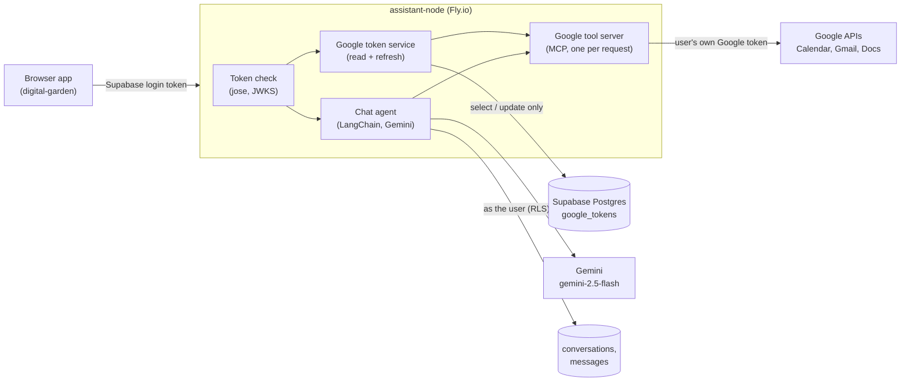

# Architecture

This document goes one level deeper than the [README](ReadMe.md)'s architecture overview, covering how individual subsystems are actually implemented. Start with the README for the request-flow diagram and component table; come here for the "why does it work this way" detail.

## Response caching

LLM calls are slow (real network round-trips) and billed per token, so the gateway avoids repeating identical work when it safely can. The design constraint is that most LLM sampling is **non-deterministic**: with `temperature > 0`, the same prompt can legitimately produce different text on every call. Caching that output and replaying it later wouldn't just be imprecise — it would misrepresent what the model would actually say now. `temperature: 0` (greedy decoding) is the one case where a provider is effectively promising "the same input produces the same output," so that's the only case the gateway caches.

### How a request flows through the cache

Implemented in [`Caching/CachedChatCompletionService.cs`](src/LlmGateway.Api/Caching/CachedChatCompletionService.cs), which sits directly in front of `LlmProviderRouter`:

1. **Cacheability check** — only requests with `temperature == 0` are eligible. Anything else skips the cache entirely and always calls through live.
2. **Cache key** — a SHA-256 hash of `{ model, temperature, messages }` ([`CacheKeyGenerator.cs`](src/LlmGateway.Api/Caching/CacheKeyGenerator.cs)). The key deliberately **excludes `callerId`**: two different callers asking the identical deterministic question share one cache entry rather than each paying for their own copy. This is a shared, content-addressed cache, not a per-caller one.
3. **Read-through**:
   - **Hit** — return immediately. `cacheHit: true` in the response, and `latencyMs` reflects the actual cache lookup time (not the original provider latency from when the entry was written).
   - **Miss** — fall through to `LlmProviderRouter`, which runs the full retry → circuit-breaker → provider-fallback chain exactly as it would with no cache in the picture. On success, the response is written to the cache with a TTL before being returned.
4. **TTL** (`Cache:DefaultTtlSeconds`, default 300s) — even "deterministic" outputs can drift over time, since a provider can silently swap which model version sits behind a deployment name. Nothing is cached indefinitely.

### Failure handling: cache is optional, never a hard dependency

`RedisCacheStore` wraps every Redis call in a try/catch. A lookup failure is logged as a warning and treated as a cache miss; a write failure is logged and silently skipped. This means a Redis outage degrades the gateway to "every request calls the LLM directly" — it gets slower, but it never breaks. This mirrors the same philosophy applied to provider calls (retry/circuit-breaker/fallback): external dependencies fail, and the gateway's job is to keep working anyway, just without the optimization that dependency provided.

The `Cache:Enabled` flag (default `true`) lets the cache be turned off entirely — useful for environments without Redis available, or for isolating cache behavior while debugging. When disabled, `NullCacheStore` is registered instead of `RedisCacheStore`: every lookup misses, every write is a no-op, and `CachedChatCompletionService`'s logic is otherwise unchanged.

### Why exclude `callerId` from the key?

The alternative — scoping the cache per caller — would mean two services asking the exact same deterministic question each pay for their own LLM call and get their own cache entry. Since the whole point of caching a deterministic call is "this input has exactly one correct output," there's no correctness reason to duplicate that work per caller. What's shared is only the underlying computation: each caller who hits the shared entry still gets their own `RequestLogEntry` (correct `callerId`, `costUsd`, `cacheHit: true`) via `Program.cs`'s logging call, which uses the *requesting* caller's ID, not anything from the cached payload — usage/cost attribution per caller stays accurate even though the work behind a hit was deduplicated gateway-wide.

## Assistant service on Node (`services/assistant-node`)

> **Status: work in progress.** The login check, the Google tools, the Google token service, the settings loader and the chat endpoint (`POST /assistant/chat`) are built and tested. The daily summary and PDF Q&A are not built yet. The .NET service in `src/LlmGateway.Assistant` still serves all three features and stays in place until the Node service has proved itself. Progress and open decisions are tracked in [`services/assistant-node/CHECKLIST.md`](services/assistant-node/CHECKLIST.md).

### Why move it

The .NET assistant uses a hand-written loop that calls tools, and only the two Calendar tools actually work. The Node service uses LangChain/LangGraph for the agent loop and MCP (Model Context Protocol) servers for connectors, so each connector is a small, separately testable tool server that any agent can use.

### The big picture

All lines exist today for chat. Daily summary and PDF Q&A are not drawn because they are not built.

### Components

| Part | Where | State |
|---|---|---|
| Login check: validates the Supabase token (JWKS, with a shared-secret fallback) and takes the user id from `sub` | `src/auth.ts` | built, tested |
| Settings: `config/default.json` (URLs, limits) plus environment variables (secrets), checked at startup | `src/config.ts` | built, tested |
| Google tool server: six tools, one server built per request | `src/google-mcp/` | built, tested (read paths also live) |
| Google token service and Postgres store | `src/google-tokens/` | built, tested (live) |
| Chat: one turn (history, tools, agent, save), conversation store, message mapper, system prompt | `src/chat/` | built, tested; checked live with Gemini and Google (saving to Supabase checked only against a fake database and the database's rules) |
| Chat endpoint and startup wiring | `src/app.ts`, `src/wiring.ts` | built, tested |
| Daily summary, PDF Q&A | not started | planned |

### Google tools (MCP)

The tool server lives in `src/google-mcp/`. For every request a fresh server is created with that user's Google access token held only in its closure, so a tool call can never use another user's token.

| Tool | What it does |
|---|---|
| `list_events`, `create_event` | Read and add events on the primary calendar (all-day events handled) |
| `search_emails` | Gmail search; returns subject, sender, date, snippet |
| `create_draft` | Saves a Gmail draft. **Nothing in the service can send email**; the user reviews and sends the draft themselves |
| `read_doc`, `append_to_doc` | Read a Google Doc (cut at 20,000 characters) and add text to the end |

Safeguards: Google's error text is never passed to the model, line breaks in the address or subject are refused (blocks hidden recipients), Google Doc ids are restricted to the characters Google uses, and tool descriptions tell the model that email and document text is data, not instructions.

### How a chat request flows

1. The browser sends `POST /assistant/chat` with the user's Supabase login token. The token is checked and the user id is taken from it.
2. Conversations are read and written with a Supabase client that carries the **user's own token**, so the database's row-level security decides what that user may see. The service holds no powerful database key for this. A `conversationId` that belongs to someone else looks exactly like one that does not exist (404).
3. The Google token service supplies the user's Google token, and a fresh Google tool server is connected to the agent in memory (no network hop). If the user has not connected Google, the chat continues without those tools and the model is told.
4. The agent (LangChain `createAgent` with `gemini-2.5-flash`) answers, calling tools as needed, up to 5 tool rounds. Going over that gives a polite "couldn't finish" reply, not an error.
5. All new messages of the turn are saved in one insert. Messages are stored in the same format the .NET service uses, so a conversation can be continued by either service.

### How a user's Google token is handled

1. The Google connect flow (first sign-in with Google) still runs in .NET. It stores the token in `google_tokens`.
2. Per request, the token service reads the row. If the token has more than 60 seconds left it is used as is. Otherwise it is refreshed with Google and saved. Simultaneous requests for one user share a single refresh.
3. If the user never connected, or Google says access was revoked, the user gets a "please reconnect" message.
4. The service reads the table through a dedicated database login, `assistant_tokens`, created by `supabase/migrations/20261116000000_google_tokens_server_only.sql`. That login can only select and update `google_tokens`; it is refused for every other table and for delete and insert. The same migration removed the old rule that let a signed-in browser read its own refresh token.

### Decisions and why

| Decision | Reason |
|---|---|
| Our own Google tool server instead of Google's hosted MCP servers | Google's hosted servers are in Developer Preview and need a company-domain account. They also cannot send mail and have no append tool. |
| Conversations stored as the signed-in user (row-level security), not with a server key | No powerful secret for chat data; the database enforces ownership. The security rules were checked in a test that rolls back. |
| Google tools connected to the agent in memory, with our own small MCP-to-LangChain converter | `@langchain/mcp-adapters`' `loadMcpTools` (v2.0.3) needs a newer MCP client than the SDK we install and fails at runtime. We only need `listTools` and `callTool`, so ~25 lines of our own are simpler and tested. |
| Draft-only email | Matches the existing "never auto-submit" rule; a model error cannot send a message |
| Narrow database login for tokens | If the connection string leaks, only Google tokens are exposed, not the whole database |
| `config/default.json` for URLs and limits, environment for secrets | No URLs or tunable numbers in code; secrets never in git |
| TLS always on to the database | The pooler accepts plain-text connections otherwise. The certificate is not verified yet (see the checklist). |
| New Node service beside .NET, not behind it | Cut over by changing one URL in the app; .NET stays as the rollback |

### Configuration and secrets

Non-secret settings live in `services/assistant-node/config/default.json`. Secrets (`SUPABASE_DB_URL`, `GOOGLE_CLIENT_SECRET`, `GOOGLE_API_KEY`) live in a git-ignored `.env` locally and in Fly secrets in production, set with `scripts/set-fly-secrets.ps1`. Details: [`services/assistant-node/README.md`](services/assistant-node/README.md).
