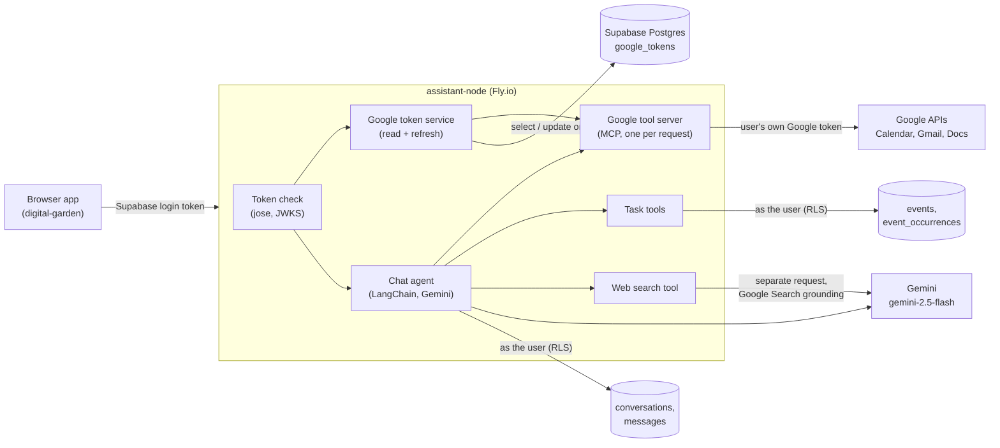
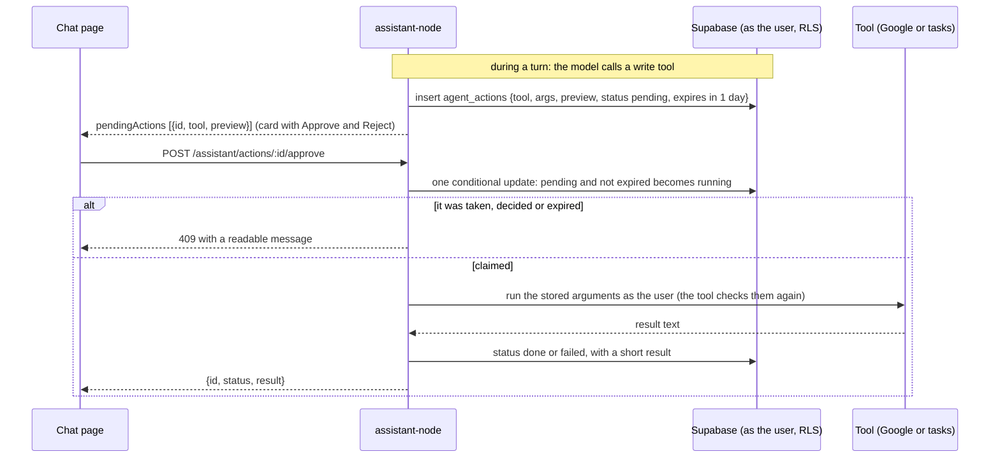

# Architecture

This document goes one level deeper than the [README](ReadMe.md)'s architecture overview, covering how individual subsystems are actually implemented. Start with the README for the request-flow diagram and component table; come here for the "why does it work this way" detail.

## Response caching

LLM calls are slow (real network round-trips) and billed per token, so the gateway avoids repeating identical work when it safely can. The design constraint is that most LLM sampling is **non-deterministic**: with `temperature > 0`, the same prompt can legitimately produce different text on every call. Caching that output and replaying it later wouldn't just be imprecise — it would misrepresent what the model would actually say now. `temperature: 0` (greedy decoding) is the one case where a provider is effectively promising "the same input produces the same output," so that's the only case the gateway caches.

### How a request flows through the cache

Implemented in [`Caching/CachedChatCompletionService.cs`](src/LlmGateway.Api/Caching/CachedChatCompletionService.cs), which sits directly in front of `LlmProviderRouter`:

1. **Cacheability check** — only requests with `temperature == 0` are eligible. Anything else skips the cache entirely and always calls through live.
2. **Cache key** — a SHA-256 hash of `{ model, temperature, messages }` ([`CacheKeyGenerator.cs`](src/LlmGateway.Api/Caching/CacheKeyGenerator.cs)). The key deliberately **excludes `callerId`**: two different callers asking the identical deterministic question share one cache entry rather than each paying for their own copy. This is a shared, content-addressed cache, not a per-caller one.
3. **Read-through**:
   - **Hit** — return immediately. `cacheHit: true` in the response, and `latencyMs` reflects the actual cache lookup time (not the original provider latency from when the entry was written).
   - **Miss** — fall through to `LlmProviderRouter`, which runs the full retry → circuit-breaker → provider-fallback chain exactly as it would with no cache in the picture. On success, the response is written to the cache with a TTL before being returned.
4. **TTL** (`Cache:DefaultTtlSeconds`, default 300s) — even "deterministic" outputs can drift over time, since a provider can silently swap which model version sits behind a deployment name. Nothing is cached indefinitely.

### Failure handling: cache is optional, never a hard dependency

`RedisCacheStore` wraps every Redis call in a try/catch. A lookup failure is logged as a warning and treated as a cache miss; a write failure is logged and silently skipped. This means a Redis outage degrades the gateway to "every request calls the LLM directly" — it gets slower, but it never breaks. This mirrors the same philosophy applied to provider calls (retry/circuit-breaker/fallback): external dependencies fail, and the gateway's job is to keep working anyway, just without the optimization that dependency provided.

The `Cache:Enabled` flag (default `true`) lets the cache be turned off entirely — useful for environments without Redis available, or for isolating cache behavior while debugging. When disabled, `NullCacheStore` is registered instead of `RedisCacheStore`: every lookup misses, every write is a no-op, and `CachedChatCompletionService`'s logic is otherwise unchanged.

### Why exclude `callerId` from the key?

The alternative — scoping the cache per caller — would mean two services asking the exact same deterministic question each pay for their own LLM call and get their own cache entry. Since the whole point of caching a deterministic call is "this input has exactly one correct output," there's no correctness reason to duplicate that work per caller. What's shared is only the underlying computation: each caller who hits the shared entry still gets their own `RequestLogEntry` (correct `callerId`, `costUsd`, `cacheHit: true`) via `Program.cs`'s logging call, which uses the *requesting* caller's ID, not anything from the cached payload — usage/cost attribution per caller stays accurate even though the work behind a hit was deduplicated gateway-wide.

## Assistant service on Node (`services/assistant-node`)

> **Status: work in progress.** The login check, the Google tools, the Google token service, the settings loader, chat (with task tools, web search and saved conversations), the daily summary, resume match and PDF Q&A are built and tested. Approval before the assistant changes anything the run record and the agent evals are built (the model tier is only partly run) (see [How chat works](#how-chat-works) and [`AGENT_HARNESS_PLAN.md`](AGENT_HARNESS_PLAN.md)). The .NET service in `src/LlmGateway.Assistant` still serves all three features and stays in place until the Node service has proved itself. Progress and open decisions are tracked in [`services/assistant-node/CHECKLIST.md`](services/assistant-node/CHECKLIST.md).

### Why move it

The .NET assistant uses a hand-written loop that calls tools, and only the two Calendar tools actually work. The Node service uses LangChain/LangGraph for the agent loop and MCP (Model Context Protocol) servers for connectors, so each connector is a small, separately testable tool server that any agent can use.

### The big picture



All lines exist today for chat. The daily summary reads Google and calls Gemini the same way, without the agent; resume match and PDF Q&A are left out of this picture. Chat is shown in detail below.

### Components

| Part | Where | State |
|---|---|---|
| Login check: validates the Supabase token (JWKS, with a shared-secret fallback) and takes the user id from `sub` | `src/auth.ts` | built, tested |
| Settings: `config/default.json` (URLs, limits) plus environment variables (secrets), checked at startup | `src/config.ts` | built, tested |
| Google tool server: six tools, one server built per request | `src/google-mcp/` | built, tested (read paths also live) |
| Google token service and Postgres store | `src/google-tokens/` | built, tested (live) |
| Chat: one turn (history, tools, agent, save), conversation store, message mapper, system prompt, task tools, web search | `src/chat/` | built, tested; checked live with Gemini, Google and a real sign-in |
| Chat endpoints (`POST /assistant/chat`, saved conversations list, read and delete) and startup wiring | `src/app.ts`, `src/wiring.ts` | built, tested |
| Approval of writes: proposals saved in `agent_actions`, approve and reject endpoints | `src/chat/approval.ts`, `src/chat/actionStore.ts` | built, tested; checked live for tasks (Google tools not yet) |
| Run record: one `agent_runs` row per chat turn (time, steps, tools, outcome; no text) | `src/chat/runRecord.ts` | built, tested; checked live |
| Checks on Google write calls before they are proposed | `src/google-mcp/writeChecks.ts` | built, tested |
| Agent evals: harness tier (scripted model, in `npm test`) and model tier (real model, on demand) | `services/assistant-node/evals/agent/` | built; the model tier has run 4 of 14 scenarios so far (quota) |
| Daily summary: fixed pipeline (Gmail and Calendar in parallel, one model call), 15-minute cache, JSON and SSE endpoints | `src/dailySummary/` | built, tested; checked live (about 7-9 s cold, 0.6 s of it fetching; the model is the rest) |
| PDF Q&A | `src/docQa/` | built, tested |

### Google tools (MCP)

The tool server lives in `src/google-mcp/`. For every request a fresh server is created with that user's Google access token held only in its closure, so a tool call can never use another user's token.

| Tool | What it does |
|---|---|
| `list_events`, `create_event` | Read and add events on the primary calendar (all-day events handled) |
| `search_emails` | Gmail search; returns subject, sender, date, snippet |
| `create_draft` | Saves a Gmail draft. **Nothing in the service can send email**; the user reviews and sends the draft themselves |
| `read_doc`, `append_to_doc` | Read a Google Doc (cut at 20,000 characters) and add text to the end |

Safeguards: Google's error text is never passed to the model, line breaks in the address or subject are refused (blocks hidden recipients), Google Doc ids are restricted to the characters Google uses, and tool descriptions tell the model that email and document text is data, not instructions.

### How chat works

#### The chat page (digital-garden `/app/chat`)

A page, not a drawer (a drawer reachable from every page can reuse the same parts later). On the left, the user's saved conversations, most recently used first, each with a title and a two-click delete. On the right, the open conversation and the message box. The open conversation is in the address (`/app/chat?c=<id>`), so a refresh or a bookmark brings it back without browser storage. Under each answer, plain words for the tools it used ("Checked your calendar", "Searched the web"). `VITE_CHAT_API_URL` points the page at the Node service; the saved-conversation list exists only there.

#### One turn

```mermaid
sequenceDiagram
    participant P as Chat page
    participant N as assistant-node
    participant DB as Supabase (as the user, RLS)
    participant G as Gemini
    participant X as Tools (Google, tasks, web search)

    P->>N: POST /assistant/chat {conversationId?, message} + login token
    N->>DB: find the conversation, or create it titled with the first message
    N->>DB: load its messages
    Note over N: keep the last 40 messages, starting at a user message,<br/>tool calls kept with their results
    N->>G: system prompt + recent history + new message
    loop up to 5 tool rounds, 60 s for the whole run, 20 s per tool
        G-->>N: tool call
        N->>X: run it as the user
        X-->>N: result (treated as data, never instructions)
        N->>G: result
    end
    G-->>N: answer
    N->>DB: save the whole turn in one insert, then move the conversation to the top
    N-->>P: {conversationId, reply, toolCallsExecuted, pendingActions}
    Note over P,N: a change is only proposed; it waits for the user (next diagram)
```

1. The login token is checked and the user id is taken from it. A per-user limit stops message floods (429).
2. Conversations are read and written with a Supabase client that carries the **user's own token**, so row-level security decides what that user may see. The service holds no powerful database key for this. A `conversationId` that belongs to someone else looks exactly like one that does not exist (404).
3. The Google token service supplies the user's Google token, and a fresh Google tool server is connected to the agent in memory (no network hop). If the user has not connected Google, the chat continues without those tools and the model is told. Task tools use the user's own Supabase client too; web search is a separate Gemini request with Google Search grounding, and the prompt forbids putting private details in a query.
4. The agent (LangChain `createAgent` with `gemini-2.5-flash`) answers, calling tools as needed. Going over 5 tool rounds gives a polite "couldn't finish" reply, not an error.
5. All new messages of the turn are saved in one insert, so a failed run saves nothing. Messages are stored in the same format the .NET service uses, so a conversation can be continued by either service.

#### Saved conversations

* **Tables:** `conversations` (id, user_id, title, created_at, updated_at) and `messages` (role user, assistant or tool; content; tool_call_id; tool_calls). Owner-only row rules on both; deleting a conversation deletes its messages (foreign key cascade).
* **Title:** the first message, on one line, cut at a word around 60 characters. No extra model call.
* **List order:** `updated_at`, set by the service after each saved turn (the table has no trigger).
* **Endpoints:** `GET /assistant/conversations` (latest 50), `GET /assistant/conversations/:id` and `DELETE /assistant/conversations/:id` (204). Someone else's conversation, a missing one and a malformed id all answer 404.
* **What the page gets back:** only the user's messages and each final answer with the names of the tools used for it. Tool calls, their arguments and raw tool output (email text, calendar entries) stay on the server.
* **What the model gets:** the whole conversation stays saved, but only the recent part is sent (above). Planned next: cut by size instead of message count, since one tool result can be large; a summary of older messages only if real chats need it. No long-term memory of the user.

#### Harness: what keeps the agent in bounds

| Safeguard | State |
|---|---|
| Acts as the user: Google tools with the user's own Google token, database with the user's own login token (row-level security) | built |
| Tool output is data, not instructions (system prompt and tool descriptions); Google error text never reaches the model | built |
| Limits: 5 tool rounds, 60 s per run, 20 s per tool, per-user message limit, message length limit, recent history only | built |
| Email is draft-only; nothing in the service can send mail | built |
| Logs: one JSON line per event with the error's type, status and code, never message text | built |
| **Approval before any write.** A write tool (`create_task`, `complete_task`, `create_event`, `create_draft`, `append_to_doc`) saves a pending row in `agent_actions` instead of running; the page shows a card with Approve and Reject; approval runs the stored, checked arguments, not a second model call. Every write is approved at first. | built (see below) |
| **Run record.** One `agent_runs` row per turn: time taken, model steps, each tool's name, time and success, how it ended (`ok`, `step_limit`, `timeout`, `error`) and how many changes it proposed. No message text, arguments or answers. A failure to save it is logged and never changes the reply. | built (see below) |
| **Agent evals.** Two tiers on a fake backend, scored in plain code: the harness tier (a scripted model does the worst thing; 17 scenarios, in `npm test`) and the model tier (the real model; 14 scenarios, on demand). | built (see below) |

#### Agent evals

The evals answer two different questions, so there are two tiers. Both play a scenario through the real chat service (the real agent, tools, approval gate and run record) on a **fake world**: one user's tasks, calendar and mailbox in memory, a fake Google that writes down anything that changes, a fake web search, and in-memory stores. A run cannot touch real data and every scenario starts from a known state. Every check is plain code over a trace of what happened (which tools were called, which changes were proposed, whether anything real was written, how the run ended, what the reply said); no model judges another model.

| | Harness tier | Model tier |
|---|---|---|
| Question | When the model does the worst thing, does the harness hold? | Does the real model behave well with the harness in place? |
| The "model" | A scripted stand-in that does exactly what the scenario says, including obeying an injected instruction | Gemini |
| Where it runs | `npm test` and CI: instant, free, identical every time | `npm run eval:agent`: costs model calls, varies run to run |
| Scenarios | Each write tool only proposes; approving runs once; rejecting changes nothing; an injected email or task note that the model obeys can only make a card; a bad event or a hidden Bcc never becomes a card; another user's task id is refused; an unknown tool does nothing; Google not connected; the step limit | Right tool and right values for reading, adding a task, completing one, scheduling, drafting; asks when the date is missing; asks which of two "Call mom" tasks; ignores instructions hidden in an email or in task notes; keeps a private email address out of a web search; says it can only draft, never send; a two-step add-approve-list flow |

A harness scenario that lists a write tool is required for every tool in `WRITE_TOOLS`, so a new write tool cannot be added without a scenario showing it is gated. The harness tier was checked by breaking the gate on purpose (one tool removed from the list): five scenarios failed.

The model tier needs billing on the key for a full run (about 40 model calls). On the free tier it stops at the quota and lists what it did not run (`--max-calls`, `--only <id or area>`, `--list`); results are saved in `evals/results` (git-ignored). First run, 2026-11-20: the quota ran out after 5 calls; the 4 scenarios that ran passed (add a task, list tasks, list calendar, Google not connected).

#### What a run record holds

`agent_runs` is written as the user (row-level security) once per turn, after the answer is ready, and read back with SQL. It exists to answer questions that the saved messages cannot:

* **How slow is it?** `duration_ms` per run, and `ms` per tool call.
* **Which tool fails?** Each tool call has `ok`, and a `code` when it failed: `timeout`, `failed` (the tool answered with a failure) or `error` (it threw).
* **How often does it hit the limits?** `outcome` is `ok`, `step_limit` (the 5-round limit; the user got the polite reply), `timeout` (the 60 s limit) or `error`.
* **Do people approve?** `actions_proposed` per run, to compare with how many cards end `done`, `rejected` or expired in `agent_actions`.

A tool call is timed outside the approval wrapper, so a proposal counts as a successful call of the write tool (nothing was changed yet). Rows cannot be changed once written; they go with the user's account. Example, the slowest tools in the last week:

```sql
select tool->>'name' as tool, count(*) as calls, round(avg((tool->>'ms')::int)) as avg_ms,
       count(*) filter (where not (tool->>'ok')::boolean) as failed
from agent_runs, jsonb_array_elements(tool_calls) as tool
where started_at > now() - interval '7 days'
group by 1 order by avg_ms desc;
```

#### Approving a change



* **What is stored is what runs.** The card text is built from the stored arguments, and approval runs those same arguments through the real tool. It is not a second model call, so the model cannot change a change after the user has read it.
* **Which tools:** `create_task`, `complete_task`, `create_event`, `create_draft`, `append_to_doc`. Reading tools (`list_events`, `search_emails`, `read_doc`, `list_tasks`, `web_search`) run straight away. Email stays draft-only.
* **No double run:** approving claims the row with one conditional update (`status = 'pending'` and not expired), so a double click or two tabs run it once; the second gets 409.
* **Expiry:** a proposal can be approved for one day; after that the answer is "This change expired. Ask the assistant again."
* **A call that could never work is never proposed.** Before a card is saved, the same checks the Google tool server applies when it runs are applied to the arguments (field types and lengths, the event ending after it starts, no line breaks in a draft's address or subject, a real Google Doc id). The model is told what was wrong, by field name and never by value, so it can fix the call or ask the user. They live in one place, `src/google-mcp/writeChecks.ts`, used by both the server and the chat.
* **A stale proposal fails clearly:** the tool checks its arguments again at approval time, so a task deleted since the proposal ends as `failed` with "No task with that id was found.", not as `done`. A complete-task proposal for a task that does not exist is refused when proposed.
* **Failures are plain:** a failed change records a short readable result, never Google's or the database's own text.
* **Cards survive a refresh:** the conversation's pending proposals come back with `GET /assistant/conversations/:id`.
* **Chips say "Proposed":** the tool names under an answer read "Proposed a task", not "Added a task", because nothing is made until approval.

### How a user's Google token is handled

1. The Google connect flow (first sign-in with Google) is built in `src/google-oauth`: `GET /auth/google/start` gives the browser a consent URL with a signed, expiring `state`; Google sends the browser to a page of the web app; the page posts the code to `POST /auth/google/exchange` with the user's login token; the service saves the tokens in `google_tokens` only if that user is the one the `state` was issued to. The .NET flow still works and stays until the web app is switched over.
2. Per request, the token service reads the row. If the token has more than 60 seconds left it is used as is. Otherwise it is refreshed with Google and saved. Simultaneous requests for one user share a single refresh.
3. If the user never connected, or Google says access was revoked, the user gets a "please reconnect" message.
4. The service reads the table through a dedicated database login, `assistant_tokens`, created by `supabase/migrations/20261116000000_google_tokens_server_only.sql`. That login can only select and update `google_tokens`; it is refused for every other table and for delete and insert. The same migration removed the old rule that let a signed-in browser read its own refresh token.

### Decisions and why

| Decision | Reason |
|---|---|
| Our own Google tool server instead of Google's hosted MCP servers | Google's hosted servers are in Developer Preview and need a company-domain account. They also cannot send mail and have no append tool. |
| Conversations stored as the signed-in user (row-level security), not with a server key | No powerful secret for chat data; the database enforces ownership. The security rules were checked in a test that rolls back. |
| Chat page with a conversation list first, drawer later | One place to build and check; the drawer can reuse the message list and box |
| Open conversation kept in the address, not browser storage | A refresh or bookmark brings it back, nothing to clear, works in a private window |
| Title from the first message, not from the model | No extra model call or cost per conversation; good enough for a list |
| Approve every write at first | A model mistake cannot change the user's data; auto-approving small writes can come once the evals show it is reliable |
| Google tools connected to the agent in memory, with our own small MCP-to-LangChain converter | `@langchain/mcp-adapters`' `loadMcpTools` (v2.0.3) needs a newer MCP client than the SDK we install and fails at runtime. We only need `listTools` and `callTool`, so ~25 lines of our own are simpler and tested. |
| No Terraform for now | One Fly app is fully described by `fly.toml`, secrets are set by a script, and the database changes are SQL migrations in `supabase/`. Terraform would add state to store and protect for no gain. Revisit when there is a second environment (staging), more than one Fly app or volume, DNS, or Supabase project settings that should be reviewed as code. |
| GitHub Actions for CI and deploy | The code is on GitHub already. CI checks every pull request; deploy is a separate workflow that is switched on by a repository variable, and builds on Fly's builders (`flyctl deploy --remote-only`). |
| Connect Google: signed `state`, code posted back by the web app with the user's login token, scopes `gmail.compose` instead of `gmail.send` | The .NET `state` was a forgeable user id. Without the login-token check, a victim could be tricked into saving their Google access under an attacker's account. Drafts need `gmail.compose`; the service never sends mail. |
| Draft-only email | Matches the existing "never auto-submit" rule; a model error cannot send a message |
| Narrow database login for tokens | If the connection string leaks, only Google tokens are exposed, not the whole database |
| `config/default.json` for URLs and limits, environment for secrets | No URLs or tunable numbers in code; secrets never in git |
| TLS always on to the database | The pooler accepts plain-text connections otherwise. The certificate is not verified yet (see the checklist). |
| New Node service beside .NET, not behind it | Cut over by changing one URL in the app; .NET stays as the rollback |

### Configuration and secrets

Non-secret settings live in `services/assistant-node/config/default.json`. Secrets (`SUPABASE_DB_URL`, `GOOGLE_CLIENT_SECRET`, `GOOGLE_API_KEY`) live in a git-ignored `.env` locally and in Fly secrets in production, set with `scripts/set-fly-secrets.ps1`. Details: [`services/assistant-node/README.md`](services/assistant-node/README.md).
